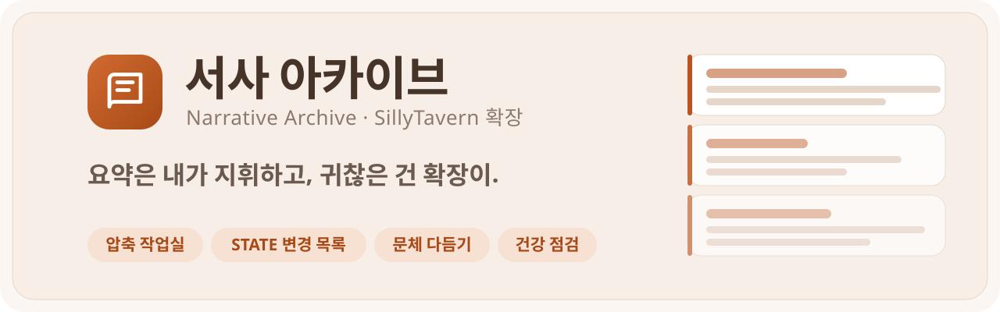
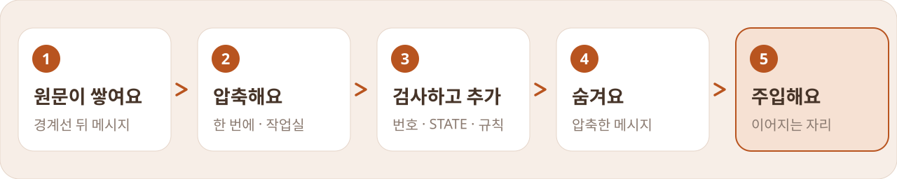

<p align="center">
  <picture>
    <source media="(prefers-color-scheme: dark)" srcset="assets/banner-dark.svg">
    
  </picture>
</p>

<p align="center">
  
  
  
</p>

<p align="center">
  <a href="#설치"><b>설치</b></a> ·
  <a href="#빠른-시작"><b>빠른 시작</b></a> ·
  <a href="#압축"><b>압축</b></a> ·
  <a href="#주입"><b>주입</b></a> ·
  <a href="#도구"><b>도구</b></a> ·
  <a href="#ai-모델-연결"><b>AI 모델</b></a> ·
  <a href="#자주-묻는-것"><b>자주 묻는 것</b></a>
</p>

<br>

**서사 아카이브**는 압축한 아카이브로 장편 RP를 이어 가는 사람을 위한 SillyTavern 확장이에요.

긴 RP를 섹션별 요약(아카이브)으로 압축해 두고, 그 아카이브를 정확한 자리에 넣어 줘요. 압축할 때마다 하던 원문 뽑기 · 붙여넣기 · 번호 맞추기 · 숨기기를 확장이 대신해요. AI로 초안을 받아도 아카이브에는 **내가 확인하고 누른 것만** 들어가요.

> [!NOTE]
> 설치만 해서는 AI 요청이 하나도 나가지 않아요. AI가 하는 일은 전부 직접 켜거나 눌렀을 때만 돌아요.

<br>

## 설치

SillyTavern → 확장 → **확장 프로그램 설치** → 주소 입력

```
https://github.com/yigasda/NarrativeArchive
```

설치하면 확장 탭에 **서사 아카이브** 패널이 생기고, 채팅 입력창 옆 마술봉 메뉴에도 들어가요.

<br>

## 빠른 시작

<table>
<tr><td width="44" align="center"><b>1</b></td><td><b>아카이브 넣기</b><br>아카이브를 쓸 채팅에서 <b>도구 → 백업 · 가져오기 → 가져오기</b>로 .txt를 넣거나, <b>아카이브 → 원문 편집</b>에 붙여넣고 저장해요. 처음이면 비워 둬도 돼요.</td></tr>
<tr><td align="center"><b>2</b></td><td><b>경계선 정하기</b><br><b>압축 → 원문 손질 · 지시문 · 경계선 → 경계선 번호</b>에 아카이브가 다루는 마지막 메시지 번호를 넣어요. 그 앞은 숨겨지고, 아카이브가 그 자리를 대신해요. <b>아카이브 따라가기</b>를 켜면 마지막 섹션 제목의 번호가 곧 경계선이에요.</td></tr>
<tr><td align="center"><b>3</b></td><td><b>초안 모델 정하기</b> <sub>(AI로 압축할 때만)</sub><br><b>⚙ 설정 → AI 모델 → 초안</b>에서 커스텀 API나 Vertex를 골라요.</td></tr>
<tr><td align="center"><b>4</b></td><td><b>압축하기</b><br>원문이 쌓이면 <b>압축</b> 탭에서 방법을 고르고 <b>압축하기</b>. 요약이 오면 <b>아카이브에 추가</b> 창에서 확인하고 넣어요. 숨기기까지 같이 돼요.</td></tr>
<tr><td align="center"><b>5</b></td><td><b>예전 방식은 끄기</b><br>프롬프트나 작가 노트에 아카이브를 직접 넣어 쓰고 있었다면 그건 꺼 주세요. 두 번 들어가요.</td></tr>
</table>

<br>

## 어떻게 돌아가나

<p align="center">
  <picture>
    <source media="(prefers-color-scheme: dark)" srcset="assets/flow-dark.svg">
    
  </picture>
</p>

- **경계선** 뒤에 원문이 쌓이면 압축해요. 압축한 메시지는 숨겨서, 아카이브와 원문이 두 번 들어가지 않아요.
- 아카이브는 숨긴 메시지 바로 뒤, 남은 대화 맨 위(**이어지는 자리**)에 들어가요. 과거 → 그 뒤 대화 순서로 읽혀요.
- 아카이브는 채팅 메타데이터에 저장돼요. 채팅 파일을 백업하면 아카이브도 같이 백업돼요.

패널은 **홈 · 아카이브 · 압축 · 도구** 네 칸과 **⚙ 설정**으로 나뉘어요. 배색은 실리태번 테마와 따로 ⚙ 설정 › 테마에서 골라요(크림 · 주황의 라이트, 따뜻한 갈색의 다크).

처음 쓰면 홈 맨 위에 **시작하기** 카드가 떠요. 초안 모델 연결 → 첫 압축으로 아카이브 만들기 → 경계선 확인, 세 단계를 확장이 알아서 체크하고(주입을 꺼 뒀으면 **주입 켜기**가 네 번째로 붙어요), 지금 할 단계는 설명과 큰 버튼으로 바로 그 화면에 데려가요. 동그라미를 누르면 그 단계 설명을 다시 볼 수 있어요. 어느 채팅에서든 단계가 다 되면 다시 안 나오고, **숨기기**로 끌 수도 있어요. 새로 설치했을 때만 떠요. 원래 쓰던 사람이 업데이트하면 처음부터 안 보여요.

<br>

## 압축

### 세 가지 방법

| 방법 | 이럴 때 |
|---|---|
| ⚡ **한 번에 압축** | 버튼 한 번. 범위를 잡아 초안 모델에 보내고, 요약이 오면 추가 창이 채워진 채로 떠요. **원문 대조**를 켜면 창이 먼저 뜨고 대조는 뒤에서 돌아요(바로 넣기를 켜면 대조가 끝난 뒤에 정해요). 문제가 나오면 **이대로 고쳐 줘**로 짚은 것만 고쳐요 |
| 💬 **압축 작업실** | 초안 모델과 장면 단위로 **대화하면서**. "대사 줄여", "순서 틀렸어"처럼 말하면 고쳐 쓰고, 그 말은 뒤 장면에도 적용돼요 |
| 🧭 **압축 마법사** | 한 화면씩 범위 → 복사 → 붙여넣기 → 채점(원문 대조, 선택) → 추가. 다른 모델(웹 채팅 등)에 직접 맡길 때 |

### 압축 방식 <sub>한 번에 압축</sub>

- **원문 그대로** (기본) — 원문을 그대로 보내요. 길면 약 2만 토큰씩 나눠 보내고, 조각마다 앞 조각이 쓴 마지막 섹션과 STATE·OPEN을 이어받아요. 자르는 자리는 늘 유저 턴 바로 앞이라 답장이 갈라지지 않고, 근처에 날짜·장소가 바뀌는 곳이 있으면 거기서 잘라요.
- **장면별** — 결이 중요할 때. AI 기능 모델이 이야기가 꺾이는 곳을 먼저 정하고, 장면마다 섹션을 따로 받아요. STATE·OPEN은 마지막에 한 번 받아요. 장면 수만큼 요청이 나가요. 작업실은 늘 장면별이에요.

<details>
<summary><b>장면별 자세히</b></summary>
<br>

- 장면은 AI 기능 모델이 범위 전체를 한 번 읽고 정해요(시간·장소, 갈등이 터지거나 풀림, 등장·퇴장, 결정, 비밀). 확인창의 **장면 나누기** 칸에서 줄을 추가하면 나누고 지우면 합쳐요.
- AI가 실패하면 메시지 속 트래커(`<tracker>` 날짜 · 장소 · 시각)로 나눠요: 날짜·도시가 바뀌거나 3시간 넘게 뛰는 곳 → 방이 바뀌는 곳, 늘 유저 턴 바로 앞에서. 트래커가 없으면 메시지 수로 잘라요.
- 장면마다 그 장면 원문, 바로 앞 섹션, 아카이브 마지막 섹션들, STATE, **작업 노트**, **문체 견본**, 압축 지시문이 같이 가요. 모델은 제목과 불릿만 쓰고, 헤더 번호는 확장이 붙여서 빈틈·겹침이 없어요.
- 장면 안에서 이야기가 확 꺾이면 섹션을 둘로 나눌 수 있어요.
- 섹션과 STATE 변경 목록은 다른 압축처럼 초안 모델이 써요.

</details>

### 요약이 좋아지는 장치

| 장치 | 하는 일 |
|---|---|
| **압축 지시문** | **기본**은 그동안의 실수를 막는 규칙(무엇을 남기나 · 감정선 · 인과 지키기 · 섹션 형식 · 문체 · STATE)을 핵심만 담았어요. 규칙을 다 길게 적은 **상세**도 있고, 직접 만들어 여러 개 저장할 수 있어요 |
| **STATE · OPEN 변경 목록** | 모델은 STATE·OPEN을 다시 쓰지 않고 `ADD` · `EDIT` · `DROP` 변경 목록만 써요. 추가 창에 체크박스로 떠서, 줄 삭제처럼 위험한 건 꺼진 채로 와요. 아무것도 안 눌러도 원래 줄이 지켜져요 |
| **출처 번호** | 불릿 문장마다 근거 메시지 번호 `(#88)`를 달게 하고, 범위 밖 번호를 확인한 뒤 저장할 때 지워요 |
| **세는 규칙 검사** | 불릿 수 · 단어 수 · 엠대시 · 금지어를 확장이 세서, 넘친 섹션만 한 번 더 고쳐 받아요. 늘 켜져 있고, 다 지키면 요청이 안 나가요 |
| **원문 손질** | 압축 → 설정 → **태그 지우기**(기본 켬 · 끄면 메시지를 그대로 보내요). 모델의 생각(`<think>` · `<thinking>` · `<thought>` · `<reasoning>`), 프리셋의 `<scene_plan>`, 글이 아닌 것(style · script · 주석 · base64)은 통째로 빼고, 나머지 HTML은 글로 바꿔요(태그 자리는 줄바꿈, 글자는 그대로 · `<state>` 같은 상태창의 날짜 · 장소도 남아요). 적을 태그 목록은 없어요. 같은 곳의 **상태창** 줄에 확장이 찾은 마지막 상태창(날짜 · 장소)이 떠요(자동, 누르면 최근 5개). **OOC 빼기**로 OOC 메모 · 나레이터(`/sys`) 메시지를 종류별로 빼요. `/comment` 메시지는 언제나 빠져요 |
| **문체 다듬기** | 받은 섹션의 문장 결만 아카이브처럼 고쳐요(톤 · 리듬 · 서술자 은유 · 감정 · 첫머리). 불릿 수 · 출처 번호 · 인용이 그대로일 때만 받아요 |
| **문체 견본 · 작업 노트** | 마음에 드는 섹션 1–2개를 목소리 견본으로, 이 이야기의 canon · 살린 줄 · 실수 목록을 노트로 장면마다 같이 보내요 |
| **이번 압축 메모** | "#40–#140은 관계 변화만"처럼 적으면 지시문 맨 끝에 가장 우선하는 지시로 붙어요 |

<details>
<summary><b>아카이브에 추가 창이 지켜 주는 것</b></summary>
<br>

- **번호 검사** — 새 섹션이 경계선 다음 번호부터 빈틈·겹침 없이 이어지는지 봐요. 빠진 구간이 있으면 **그 구간 요약 받기**나 **번호만 잇기** 버튼이 떠요.
- **이미 있는 섹션** — 모델이 아카이브에 있던 섹션을 다시 써 오면 빼고 알려 줘요. 붙여넣은 게 아카이브 전체본이면 **통째로 바꾸기**가 떠요.
- **STATE를 통째로 써 왔을 때** — 사라진 줄과 바뀐 `##` 제목을 보여 주고 되살려요.
- **언어** — 아카이브와 다른 언어로 답이 오면 다시 받을지 먼저 물어봐요.
- **미리보기** — 추가하면 아카이브가 어떻게 바뀌는지 줄 단위로 봐요.
- **이어서 고치기** — 입력칸에 "#60 이후 더 줄여줘"처럼 적으면 초안을 고쳐 받아요. 번호를 적거나 위의 섹션 칩을 고르면 **그 섹션과 그 원문만** 보내요(아래 줄에 보낼 원문 토큰이 떠요). 아무것도 안 고르면 전체를 보내요. **처음으로**로 되돌려요.
- **충돌 검사** — 철자가 한두 글자 다른 이름(AI 없이), 기존 사실·날짜·해결된 떡밥과 어긋나는 곳(AI)을 찾아요.
- **바로 넣기** (선택) — 검사가 다 통과하면 추가 창 없이 넣고 숨겨요. 알림의 **되돌리기**로 한 번에 원래대로.
- **받아 둔 요약** — 넣기 전에 탭이 닫혀도 요약은 채팅에 남아 있어서, 다시 압축을 누르면 그걸로 열지 먼저 물어봐요.

</details>

<details>
<summary><b>압축 작업실 자세히</b></summary>
<br>

- 메신저 모양이에요. 모델 답은 섹션 카드로, 내 말은 주황 말풍선으로 떠요. 위에 장면 칸이 나란히 있어요(✓ 확정 · 받음 · 지금 · 아직).
- **다음 장면** 버튼으로 하나씩, **자동 진행**을 켜면 끝까지 쭉 보내고 마지막에 STATE 쪽지까지 받아요.
- **개요 먼저**를 켜면 장면마다 흐름 3–5줄을 먼저 보고 고친 뒤 본문을 받아요.
- 답 아래 버튼: **고치기**(넘친 규칙만 다시) · **다듬기**(문체) · ↶ 되돌리기 · 복사 · **한국어**(확인용 번역) · **확정**(그 장면 잠금).
- 답을 **직접 고칠** 수도 있어요. 연필 아이콘이나 세 번 터치.
- 내가 한 말 옆 **노트에 추가**로 그 말을 작업 노트의 칸(Canon · 살린 줄 · 실수 목록 · 문체)에 넣어요.
- 대화는 채팅에 저장돼서 창을 닫았다 열어도 이어지고, **추가하기** · **여기까지 추가**로 모은 섹션을 아카이브에 넣어요.

</details>

<details>
<summary><b>AU 채팅</b></summary>
<br>

본편 아카이브를 들고 새 채팅에서 AU를 할 때, **압축 탭 → AU 채팅**에서 **이 채팅은 AU**를 켜고 AU 설정을 한 줄 적어 두면, 요약이 본편 뒤에 `# ── AU ──` 묶음(`## AU #0–#35 — …`)으로 이어져요. STATE·OPEN은 AU 기준으로 이어지는 기억만 남겨요. 모델이 앞글자나 구분선을 빼먹으면 추가할 때 붙여 줘요.

</details>

<br>

## 주입

| 기능 | 하는 일 |
|---|---|
| **이어지는 자리** (기본) | 숨긴 메시지 바로 뒤, 남은 대화 맨 위. 깊이는 답마다 확장이 세고, 압축해서 숨길 때만 자리가 바뀌어서 프롬프트 캐시도 잘 유지돼요 |
| **섹션 스위치 · 📌 고정 · 🔑 키워드** | 섹션이나 묶음을 주입에서만 빼고, 늘 원문으로 고정하고, 최근 메시지에 키워드가 나올 때만 넣어요 |
| **망각 곡선** | 섹션마다 **짧게**(원문의 약 60%) · **요점**(약 30%, 불릿 2~4개) 버전을 두면 최근 N개는 원문, 그다음은 짧게, 더 오래된 건 요점으로 들어가요. 짧은 버전이 200토큰쯤 이하인 작은 섹션은 짧게에서 멈춰요 |
| **다이제스트** | 이어진 섹션 여러 개를 짧은 섹션 하나로 줄여, 주입에는 그것만 넣어요. 원본은 그대로 남아요 |
| **AI 라우터** | 답하기 직전에 지금 대화에 필요한 지난 섹션을 골라 원문으로 넣어요. **AI 없이 빠르게**는 답마다 AI를 부르지 않고 확실할 때만 골라요: 섹션에 나온 이름(주요 인물 빼고) · 키워드가 대화에 나올 때, 상태창의 방 · 건물이 예전 장소로 돌아갈 때(도시만 같은 건 안 쳐요), 임베딩이 켜져 있으면 마지막 메시지와 뜻이 가장 가까운 섹션. 흔한 단어는 안 보고, 마지막 메시지에 무게를 둬요. 나머지 섹션은 망각 곡선대로 둬요(빼지 않아요). 불러온 섹션은 3답 동안 유지되고, 홈에 "원문으로 불러옴 · #40–#55"처럼 떠요(누르면 이유). **키워드에 더해 AI도 · 오래된 섹션 전부**는 AI 기능 모델이 골라요(20초 안에 답이 없거나 실패하면 빠른 방식으로 대신). 오래된 섹션 전부는 망각 곡선이 켜져 있으면 안 고른 섹션도 빼지 않고 짧게 둬요 |
| **캐시 아끼기** (기본 켬) | 아카이브 블록은 답마다 똑같이 두고, 그 답에만 필요한 것(키워드 · 라우터가 불러온 섹션, 지금 나오는 인물의 노트 · 누가 아는가)은 `# CALLED BACK FOR THIS SCENE`으로 마지막 메시지 두 개 바로 위에 따로 넣어요. 프롬프트 앞부분이 늘 같아서 Gemini · Claude의 프롬프트 캐시가 덜 깨지고 요금이 줄어요(Claude는 실리태번 `config.yaml`의 `claude.cachingAtDepth`를 켜야 해요). ⚙ 설정 → 주입에서 끄면 예전처럼 한 블록에 넣어요. 주입 미리보기에서 두 블록을 같이 볼 수 있어요 |
| **임베딩** | 실리태번 벡터 저장소에 섹션을 넣어 두고, 라우터가 비슷한 뜻으로도 찾아요. AI 라우터를 켰을 때만 색인을 만들어요 |
| **지난 장면 짐작하기** | "그날 밤"처럼 돌려 말하면 그 장면을 아카이브 말로 짐작해서 찾아요 |
| **누가 아는가 · 말투 지문** | 비밀을 아는 사람 표와 인물 노트를 조용히 같이 보내요 (켰을 때만) |
| **세계관 공유** | 여러 채팅이 같이 쓰는 설정을 한 번만 두고 `# WORLD`로 앞에 넣어요. 한 줄 소개 · 장소 · 소속 · 사정 · 규칙 · 이전 이야기 · 용어 칸에 "이름 + 설명"으로 쌓고, **아카이브에서 채우기**를 누르면 AI 기능 모델이 아카이브에 나온 것만 뽑아 와요(모든 칸이나 한 칸만, 바라는 것도 적을 수 있어요). 고른 것만 들어가고 바뀐 건 지금 설명과 나란히 보여요. **한국어로 보기**를 켜면 줄마다 번역이 밑에 붙어요(세계관 자체는 그대로). 줄마다 체크로 넣고 뺄 수 있고, 칸 제목의 체크로 그 칸 줄을 한 번에 켜고 꺼요(일부만 꺼지면 −) (월드 인포처럼 · 그 세계관을 쓰는 모든 채팅에 적용 · 끈 건 흐리게 남고 주입에서만 빠져요). 세계관마다 **로어북으로 내보내기**로 실리태번 월드 인포를 만들 수 있어요: 장소 · 소속 · 용어는 이름이 나올 때만(`A / B`는 둘 다 키워드), 사정 · 규칙 · 이전 이야기 · 소개는 늘 들어가는 항목. 내보낸 뒤 이 채팅의 세계관 주입을 끌지 물어봐요(두 번 들어가지 않게) |

⚙ 설정에서 **주입**은 넣는 자리 · 분량(망각 곡선 · 토큰 상한), **호출**은 뭘 불러올지(AI 라우터 · 장면 짐작 · 임베딩 · 키워드 · 고정 · 꺼 둔 섹션)예요.

**주입 미리보기**로 실제로 들어가는 최종 텍스트와 빠진 섹션·이유를 보고, **토큰 상한**을 정해 두면 넘을 때 알려 줘요.

<br>

## 아카이브 다루기

- **섹션 카드 · 타임라인 · 원문 편집** — `##` 제목은 카드로, `# ── Y1 ──` 같은 제목은 접는 묶음으로 보여요. 타임라인은 번호와 버전 상태를 점 색으로 보여 줘요.
- **읽기 모드** — 정리된 읽기 화면, 목차 이동, 글자 크기. **한국어로 읽기**로 아카이브 전체를 줄마다 번역해 봐요(번역 용어집 · 바뀐 줄만 다시 번역).
- **원문 보기** — 제목에 `#564–#567`처럼 번호가 있으면 그 메시지들을 바로 열어요(숨긴 것 · 이전 채팅 것 포함).
- **AI로 고치기** — 섹션 하나 **고쳐 달라고 하기**, 여러 섹션 **합치기**, **제목 다시 짓기**, **다이제스트**. 모두 바뀌기 전 → 후를 보고 적용해요.
- **여러 섹션 고르기** — ☑ 버튼으로 골라서 버전 · 주입 · 고정 · 합치기 · 삭제를 한 번에.
- **찾아 바꾸기 · 제목 검사** — 섹션별 미리보기, 번호 빠짐·겹침과 같은 제목 찾기.
- **분기** — 분기를 만들면 아카이브도 따라오는데, 분기 지점 뒤 섹션이 섞여 있으면 알려 주고 빼거나 되돌려요.
- **새 채팅으로 이어가기** — 빈 채팅으로 넘어가면 이어 쓸지 물어봐요. 같은 캐릭터의 다른 채팅 아카이브도 가져와요.

<br>

## 도구

| 도구 | 하는 일 |
|---|---|
| 🩺 **건강 점검** | AI 없이 번호 빈틈 · STATE 번호 · 압축할 때 · 안 숨긴 메시지 · 넓은 키워드 · 흔들린 이름 · 백업을 훑고, 고칠 수 있는 건 버튼으로 |
| 🔬 **프롬프트 X-ray** | 마지막으로 보낸 프롬프트를 아카이브 · 대화 · 월드인포 · 다른 확장 · 캐릭터 카드로 나눠 토큰 막대로 |
| 🧭 **이탈 감지** | 최근 답을 아카이브와 대조해 사실 · 관계 · 해결된 떡밥 · 모르는 걸 아는 척을 찾아요(근거를 확장이 다시 확인) |
| 🤫 **누가 아는가** | 비밀마다 아는 · 짐작하는 · 모르는 사람을 표로 |
| 🗣 **대사 은행 · 말투 지문** | 인물별 대사를 모으고, 사람됨 · 말버릇 · 실제 대사로 인물 노트를 만들어요 |
| 👥 **인물 도감 · 관계도 · 관계 온도** | 프로필과 얼굴, 가까운 사람 지도, 섹션마다 −5~+5 온도 곡선. 아카이브 제목 줄(`# A × B — …`)의 두 사람은 이름 대신 he/she로 적힌 섹션에도 나온 걸로 쳐요 |
| 📅 **이야기 달력** | 제목 속 날짜로 섹션을 시간순으로, 빈 곳 · 거꾸로 가는 곳 표시. **기념일**: AI 기능 모델이 섹션을 읽고 첫 만남 · 고백한 날 · 첫 키스 같은 날을 찾아 달력 맨 위에 모아요(이름 고치기 · 빼기 · + 로 직접 추가, 새로 압축하면 새 섹션에서만 다시 찾기). 이야기 속 날짜(최근 상태창, 없으면 마지막 섹션)가 그날로 돌아오면 홈에 "이야기 속 오늘은 고백한 날 1년째예요" 한 줄이 떠요 |
| 📱 **캐릭터 휴대폰** | 인물 하나의 폰을 아카이브에 있는 만큼만 보여 줘요: 잠금화면 · 메시지(보내지 않은 초안이 입력창에 남아요 · 없으면 **떠올리기**로 AI 기능 모델이 그 사람에게 못 보낸 말을 하나 상상 — 상상한 초안은 롤플에 안 들어가요) · 통화 기록(부재중만 보기 · 사람마다 기록) · 연락처(인물 도감 내용 · 최근 통화 · 대화방으로) · SNS(주인 계정 · 글 · 좋아요 · 댓글, 게시물 사진도 **그리기** — 그린 뒤엔 그림만 보이고 ⋯(또는 꾹 누르기)에 태그 · 다시 그리기 · 저장, 북마크는 저장) · 메일 · 일기(아카이브에 나온 일과 감정만 · 연필 버튼을 누르면 지금 장면의 일기 한 편) · 설정(테마 · 국적 · 한국어 보기 · 외모 · 참고 로어북 · 롤플에 넣기 · 새로 일어난 일 반영 · 다시 만들기(앱마다 골라서, 고른 앱만 아카이브 전체로 다시 채워요) · 지우기) · 카메라(누르면 지금 장면의 사진 한 장을 AI 기능 모델이 써서 사진첩에 넣어요. 카메라 · 새 메모 · 일기 쓰기는 아카이브 대신 최근 본문만 읽어요) · 사진첩(설명 카드, 사진마다 **그리기** — 그린 뒤엔 그림과 설명, 그 아래 저장 · 정보(태그) · 다시 그리기 아이콘(꾹 눌러도 같아요): AI 기능 모델이 설명을 영어 단부루 태그로(사진 한 줄 + 사람마다 한 줄) 바꾸고 실리태번 이미지 생성(NovelAI 등)이 조용히 그려요. 인물 외모는 사진첩 오른쪽 위 **외모**에서 사람마다 적어 두면(모든 채팅) 그대로 들어가요. **오토픽(AutoPic)**을 직접 생성 모드로 쓰면 오토픽으로 그려요: 오토픽의 모델 · 바이브 · 등록 캐릭터 외모를 쓰고(등록된 사람은 외모 칸보다 오토픽 외모가 먼저), 사진에 나온 사람만 캐릭터 프롬프트로 넣어요(레퍼런스 이미지는 빠져요). 오토픽이 안 되면 실리태번 이미지 생성으로 돌아가요) · 메모(**새 메모**로 지금 장면의 메모 한 편) · 브라우저(검색 기록 · 열린 탭 · 북마크 · 방문 기록, 결과는 처음 열 때 한 번 만들고 결과를 누르면 페이지로)(하나를 처음 열면 AI 기능 모델이 그 검색의 결과 페이지를 만들어 두어요) · 캘린더(기념일 포함 · 그 장면에 나온 사람 폰에만) · 다녀간 곳(제목 속 장소를 장소마다 한 줄로 · 몇 번 갔는지, AI 없이). 초안 모델이 한 번에 채우고, 글은 그 인물 국적에 맞는 말로 쓰고 한국어를 밑에 붙여요(**가 한국어**로 숨기기). 날짜 · 시간도 그 나라 식으로. **번역 용어집**(도구 탭 · ⚙ 설정 · 폰 설정 앱)에 적은 이름은 폰에서도 그 표기 · 풀네임으로 써요. 연락처는 그 인물이 저장해 둔 이름으로 떠요. **새로 일어난 일 반영**은 새 섹션만 보내서 덧붙여요. 설정 앱의 **참고 로어북**에서 로어북을(› 누르면 항목별로) 고르면 같이 읽어요(이 채팅의 모든 폰, 합쳐서 2만 토큰까지는 통째로, 넘으면 그 인물 항목 → 항상 켜진 항목 순). 인물 바꾸기와 로어북에만 있는 인물 넣기는 설정 앱 맨 위 이름에서 해요(폰을 만들기 전엔 카드의 **인물 바꾸기**). 홈 · 잠금화면은 클리어 글래스 디자인이고, 앱은 실제 폰 앱 배치에 홈과 같은 글래스 버튼 · 흰 카드 · 앱마다 한 색으로 그려요(SNS · 일기는 각자 모양). 설정 앱의 **테마**에서 컬러 젤(기본) · 화이트 그레이를 골라요. 설정 앱의 **롤플에 넣기**를 켜면 최근 문자 · 부재중 · 일정이 주입돼요(기본은 꺼짐, AI가 재구성한 기록은 빼고). **누가 아는가** 표에서 폰 주인이 모르는 사실은 폰에 안 나와요. 앱을 다시 만들어도 그린 그림 · 읽음 · 검색 결과는 남아요. 도구 탭이나 인물 도감 카드의 **휴대폰**에서 열어요. 폰은 화면 전체에 한 겹으로 떠요: 설정은 다 폰 안 설정 앱에 있고, 홈 · 잠금화면 맨 아래 **닫기** 막대(앱 안에선 홈으로)나 폰 바깥을 누르면 닫혀요 |
| 🗂 **복구 지점 · 변경 내역** | 바꾸기 직전 상태를 자동으로 남기고, 두 버전을 비교해 되돌려요 |
| 💾 **가져오기 · 내보내기** | `.txt`는 현재 아카이브 글만, `.json`은 경계선 · 설정 · 복구 지점까지. 백업 알림(기본 10번 바뀔 때마다) |

마술봉 메뉴의 **서사 아카이브**에서도 읽기 · 질문 · 압축 · 도구를 바로 열어요. 홈의 **질문**으로 아카이브에 채팅처럼 물어볼 수 있어요(맞는 섹션과 원문 몇 줄만 보내요).

<br>

## AI 모델 연결

**⚙ 설정 → AI 모델**에서 일마다 모델을 따로 정해요.

| 탭 | 하는 일 |
|---|---|
| **AI 기능** | 질문 · 라우터 · 검사 · 고치기 · 다듬기 · 장면 나누기처럼 자주 부르는 일. 싼 모델 추천. 번역을 다른 모델로 돌리는 스위치도 여기 |
| **초안** | 압축 · 원문 보고 다시 쓰기. 압축할 때 생각은 기본 **높게**(답 한도 32,000) |

임베딩은 **⚙ 설정 → 호출 → 임베딩**에 있어요. 실리태번 벡터 저장소 설정을 따르거나 직접 골라요.

연결 방식은 이렇게 골라요.

- **지금 연결된 모델** · 실리태번 **연결 프로필**
- **커스텀 API** — OpenAI 호환 또는 Anthropic 형식. 주소와 키를 넣고 **불러오기**로 모델 목록에서 골라요. 브라우저에서 바로 불러서 CORS를 막는 API는 못 써요
- **Gemini Vertex** — 실리태번 API 연결에 저장한 서비스 계정을 그대로 써요. 요청은 실리태번 서버가 보내서 키가 브라우저에 오지 않아요

모델이 거절하거나 안전 필터에 막히면 다른 모델로 한 번 더 보낼 수 있어요(⚙ 설정 › AI가 하는 일). 거절한 답은 아카이브에 들어가지 않아요.

<br>

## 아카이브 형식

```markdown
# Mara × Ren — Context Archive (#0–#120)

## #0–#18 — The north road (Spring 3, night, Varo)
PLOT:
- Mara came back the same night she had sworn to leave …
- …

---
# STATE AT #120 (Spring 9, evening, Varo)
## Mara
- …
# OPEN AT #120
- …
```

- `## ` 제목이 섹션 카드가 돼요. 제목에 번호 범위(`## #0–#18 — 제목`)를 넣으면 원문 보기 · 번호 검사 · 경계선 자동이 다 돼요.
- `# ── Y1 ──`처럼 `#` 제목 바로 아래 `##`가 오면 묶음 구분선이에요. `## Y2 #574–#600 — 제목`처럼 접두어도 써요.
- 끝의 `# STATE AT …` / `# OPEN AT …`은 지금 상태와 열린 실마리예요. 새 섹션은 그 앞에 들어가요.
- `###` 이하는 카드 안 소제목이고, 코드 블록 안 `#` 줄은 제목으로 보지 않아요.

<br>

## 자주 묻는 것

<details>
<summary><b>돈이 얼마나 드나요?</b></summary>
<br>

설치만 해서는 0원이에요. 압축 · 라우터 · 검사처럼 AI가 하는 일은 켜거나 눌렀을 때만, 고른 모델로 나가요. 한 번에 압축 확인창에 요청 수와 보낼 토큰 어림값이 먼저 보여요. 건강 점검 · 키워드는 AI를 안 써요.

</details>

<details>
<summary><b>키는 어디에 저장되나요?</b></summary>
<br>

커스텀 API 키와 압축 지시문은 이 기기의 실리태번 설정에만 저장돼요. 채팅 파일이나 확장 파일에는 들어가지 않아요. Vertex는 실리태번에 저장한 계정을 서버가 쓰고, 키가 브라우저로 오지 않아요.

</details>

<details>
<summary><b>"규칙은 시스템 메시지로"는 뭔가요?</b></summary>
<br>

압축 지시문의 규칙 부분을 시스템 메시지로, 원문 · 메모 · 마지막 점검은 요청으로 나눠 보내요. 규칙이 상위 지시로 읽혀요. 기본은 꺼져 있어요. 시스템 메시지를 버리는 중계 서버나 프록시를 쓰면 켜지 마세요. 규칙이 통째로 빠진 채 요약이 나와요.

</details>

<details>
<summary><b>압축하다가 끊겼어요</b></summary>
<br>

압축 중에는 **그 탭에 있어야** 끝까지 받아요. 폰에서 다른 앱으로 가면 브라우저가 페이지를 멈출 수 있어요. 받은 요약은 넣기 전까지 채팅에 남아 있어서, 다시 압축을 누르면 그걸로 열지 먼저 물어봐요. 나눠 보내다 실패하면 거기까지 한 것만 추가 창에 넣고, 다시 누르면 이어서 해요.

</details>

<details>
<summary><b>요약이 자꾸 길거나 문장이 거슬려요</b></summary>
<br>

**세는 규칙 검사**(늘 켜져 있어요)가 넘친 섹션을 다시 받아요. 문장 결은 추가 창이나 작업실의 **다듬기**로, 목소리는 **문체 견본**으로 맞춰요. 결이 중요한 구간은 압축 방식을 **장면별**로 바꿔 보세요.

</details>

<br>

<details>
<summary><b>코드 구조</b> <sub>고치거나 기여하고 싶을 때</sub></summary>
<br>

`index.js`가 시작점이고, 기능별 코드는 `src/`에 ES 모듈로 나뉘어 있어요.

| 파일 | 하는 일 |
|---|---|
| `core.js` | 상수, 채팅별 아카이브 기록 · 전역 설정, 모든 변경이 지나가는 `commitText` |
| `sections.js` | 제목 파싱, 섹션 키 · 스위치 · 고정 · 키워드, 번호 검사, STATE/OPEN 꼬리 |
| `inject.js` · `fade.js` · `world.js` · `knowledge.js` | 주입 블록, 망각 곡선, 세계관, 누가 아는가 |
| `router.js` · `recall.js` · `embed.js` · `guess.js` | 답 직전 준비: 라우터, 낱말 색인 · OOC 빼기, 임베딩, 지난 장면 짐작 |
| `wizard.js` · `scenes.js` · `studio.js` · `prompts.js` | 한 번에 압축 · 마법사, 장면별, 작업실, 압축 지시문 |
| `append.js` · `appendtext.js` · `statechg.js` · `rulecheck.js` · `style.js` | 아카이브에 추가, STATE 변경 목록, 세는 규칙 검사, 문체 다듬기 |
| `panel.js` · `panelhtml.js` · `panelbind.js` · `panelcfg.js` · `browser.js` · `status.js` · `theme.js` | 사이드 패널(탭 · 새로고침 / HTML 틀 / 버튼 연결 / ⚙ 설정 화면), 아카이브 탭, 계기판, 배색 |
| `ai.js` · `translate.js` · `lore.js` | AI 연결(프로필 · 커스텀 API · Vertex), 번역 · 용어집, 로어북 곁들이기 |
| `phone.js` · `phonedata.js` · `phoneai.js` · `phonehome.js` · `phoneapps.js` | 캐릭터 휴대폰: 창 · 화면 전환 / 폰 데이터 · 만들기 요청 · 날짜 표기 / 사진 그리기 · 카메라 · 새로 쓰기 · 검색 결과 / 홈 · 잠금화면 / 앱 화면 |
| 나머지 | 화면 하나씩: `ask` `drift` `quotes` `health` `xray` `people` `calendar` `branches` `diff` `preview` `reader` `source` `keywords` `chats` `util` … |

</details>
